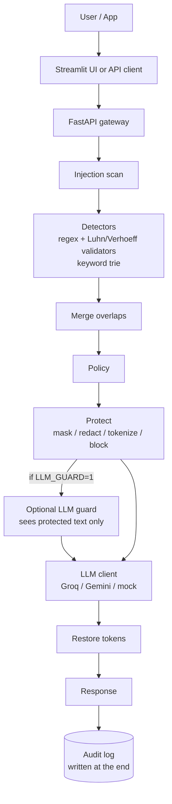
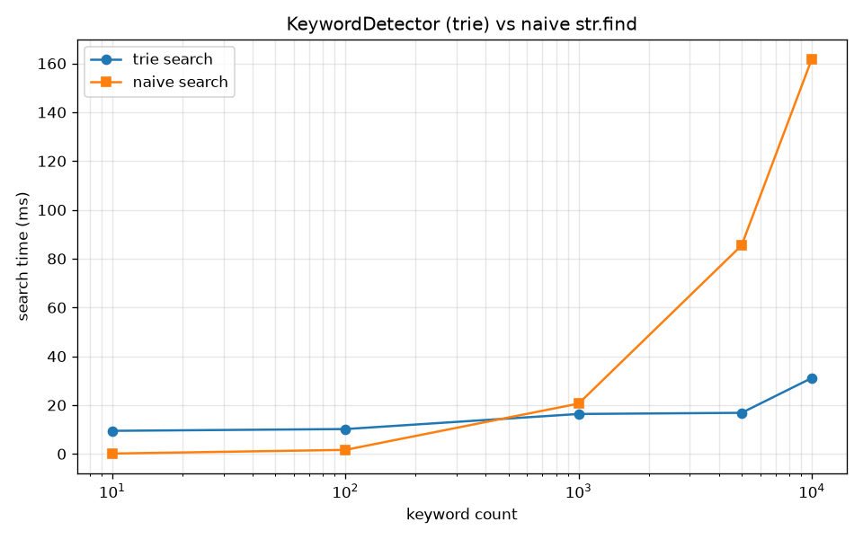

# Privacy & Safety Gateway for Generative AI Applications

**ORIGIN MINI Problem Statement 05**

A privacy and safety gateway that sits between a user (or application) and a
generative AI API. It scans every prompt for prompt-injection attempts and
sensitive data, merges overlapping detections, applies a configurable policy
(mask / redact / tokenize / block), optionally runs an LLM-based injection
guard on the already-protected text, forwards the sanitized prompt to the LLM
(Groq, Gemini, or an offline mock), restores tokens in the reply, and writes
an audit record. Raw sensitive values are never logged or stored.

## Request flow



## Walkthrough of one request

1. The user submits a prompt via the Streamlit UI or an API client
   (`POST /v1/chat`).
2. The FastAPI gateway runs the injection scanner, which scores the prompt
   (weighted rules combined as `1 - product(1 - w)`) and returns a verdict:
   `allow`, `warn`, or `block`.
3. A `block` verdict short-circuits the request: the response is
   `{"decision": "blocked", "reason": "prompt_injection", ...}` and the
   audit log is written; the LLM is never called.
4. Otherwise, all detectors run: `RegexDetector` (EMAIL, PHONE, CREDIT_CARD,
   AADHAAR, PAN, IP_ADDRESS, API_KEY — with Luhn and Verhoeff checksum
   validation) and, if configured, `KeywordDetector` (hand-written trie).
5. Overlapping detections are merged (sort-and-sweep; one winner per
   overlapping group: highest confidence, then longest, then earliest).
6. The policy resolves each detection type to an action for the selected
   profile (or the default profile).
7. `protect()` applies the actions right-to-left: `allow` keeps the value,
   `mask` partially hides it, `redact` replaces it with `[REDACTED_TYPE]`,
   `tokenize` swaps it for a `<TYPE_N>` token stored in the in-memory vault,
   and `block` aborts the request.
8. If `LLM_GUARD=1` and the rule verdict is `allow`, the LLM guard classifies
   the *protected* text; a `yes` escalates the verdict to `warn`.
9. The sanitized prompt is sent to the LLM client (`LLM_PROVIDER` =
   `groq` | `gemini` | `mock`).
10. Tokens in the reply are restored via the vault, the response is returned,
    and the audit record (types, counts, actions, score, verdict, decision —
    never raw values) is written at the end.

## Features

- PII detection: EMAIL, PHONE, CREDIT_CARD (Luhn-validated), AADHAAR
  (Verhoeff-validated), PAN, IP_ADDRESS, API_KEY (regex); KEYWORD (trie)
- Prompt-injection scan across selected classes with weighted scoring
- Overlap merging so replaced spans never conflict
- Configurable per-profile policies (`policies/policy.yaml`)
- Actions: `allow`, `mask`, `redact`, `tokenize`, `block`
- Per-request user overrides that can never weaken a `block` (`block` is not
  a valid override action)
- Optional LLM injection guard that sees only protected text (`LLM_GUARD=1`)
- LLM backends: Groq, Gemini, offline mock (`LLM_PROVIDER`)
- Token restore in the LLM reply; fresh in-memory vault per request
- Audit summary endpoint; CORS limited to `http://localhost:8501`
- Streamlit UI with review-and-send and audit dashboard tabs

## API endpoints

| Method | Endpoint | Request | Response (fake data) | Errors |
|---|---|---|---|---|
| GET | `/health` | — | `{"status": "ok"}` | — |
| GET | `/v1/profiles` | — | `{"profiles": ["student", "developer"], "default_profile": "student"}` | — |
| POST | `/v1/analyze` | `{"prompt": "Reach me at alice@example.com", "profile": "student"}` | `{"findings": [{"type": "EMAIL", "start": 11, "end": 27, "confidence": 0.85, "action": "mask"}], "injection": {"score": 0.0, "verdict": "allow", "categories": [], "guard": "off"}, "prompt_length": 27}` | 422 empty prompt; 404 unknown profile |
| POST | `/v1/chat` | `{"prompt": "Card 4111 1111 1111 1111", "profile": "student"}` | `{"decision": "blocked", "blocked_types": ["CREDIT_CARD"], "injection_verdict": "allow", "injection": {"verdict": "allow", "guard": "off"}}` | 422 empty prompt / `block` or invalid override; 404 unknown profile; 502 LLM request failed |
| POST | `/v1/chat` | `{"prompt": "Email bob@example.com", "profile": "developer", "overrides": {"EMAIL": "redact"}}` | `{"decision": "modified", "reply": "Mock reply.", "applied": [{"type": "EMAIL", "action": "redact"}], "injection_verdict": "allow", "injection": {"verdict": "allow", "guard": "off"}}` | as above |
| GET | `/v1/audit/summary` | — | `{"total_events": 2, "counts_per_type": {"EMAIL": 1}, "decisions": {"modified": 1, "blocked": 1}, "blocked_per_day": {}}` | — |

Examples use synthetic fake data only. The mock LLM echoes
`Mock reply referencing tokens: <...>` when tokens are present.

## Setup on Windows Git Bash

```bash
git clone <repo-url>
cd privacy-safety-gateway
python -m venv .venv
source .venv/Scripts/activate
pip install -r requirements.txt
```

Copy `.env.example` to `.env` (create it if it doesn't exist) and add your
keys:

```
GROQ_API_KEY=your-groq-key
GEMINI_API_KEY=your-gemini-key
LLM_PROVIDER=mock          # or groq | gemini
GROQ_MODEL=openai/gpt-oss-20b
GEMINI_MODEL=gemini-1.5-flash
LLM_GUARD=0                # set to 1 to enable the LLM injection guard
GATEWAY_URL=http://127.0.0.1:8000
```

**Never commit `.env` or paste keys anywhere.** Model names change often
(especially Gemini); always set `GROQ_MODEL` and `GEMINI_MODEL` in `.env`
to the current model you want to use.

## How to run

```bash
# Start the FastAPI gateway (auto-reload on changes)
uvicorn app.main:app --reload

# In a second terminal: start the Streamlit review UI
streamlit run ui/streamlit_app.py

# Run the test suite
pytest -q

# Evaluate detectors against the built-in dataset
python -m tests.eval
# Options:
#   --dataset PATH       (default: tests/dataset.json)
#   --out-prefix PATH    (default: benchmarks/eval_results)
#   --guard              (enable LLM guard evaluation; requires LLM_PROVIDER=groq|gemini and valid keys)
```

Why `python -m tests.eval` instead of `python tests/eval.py`?
Running as a module (`-m`) keeps imports like `from app.detectors...`
working because the package root (the repo directory) is on `sys.path`.
Running the file directly breaks those imports.

To enable the optional LLM injection guard during evaluation or at runtime:

```bash
LLM_GUARD=1 python -m tests.eval --guard
# or
LLM_GUARD=1 uvicorn app.main:app --reload
```

## Policy file

The policy is defined in `policies/policy.yaml`:

```yaml
default_profile: student
profiles:
  student:
    default_action: mask
    actions:
      EMAIL: mask
      PHONE: redact
      CREDIT_CARD: block
      API_KEY: block
  developer:
    default_action: allow
    actions:
      EMAIL: tokenize
      PHONE: tokenize
      API_KEY: block
```

- **Profiles** are named configurations selected via the `profile` query
  parameter (or the default profile).
- **Actions**: `allow` (pass through), `mask` (partially hide), `redact`
  (replace with `[REDACTED_TYPE]`), `tokenize` (swap for `<TYPE_N>` token),
  `block` (abort the request).
- **default_action** applies to any detection type not explicitly listed.
- **Overrides** (per-request via the `overrides` field in `/v1/chat`) can
  change an action to `allow`, `mask`, `redact`, or `tokenize` — but **never
  to `block`**, and an override cannot weaken a policy `block` (if the
  policy says `block`, the override is ignored and the request is blocked).

## Data structures and algorithms

| Concept | Where | Why |
|---|---|---|
| Hash map vault with reverse map | `app/vault.py` | Two dicts (`value_to_token`, `token_to_value`) give O(1) average token reuse on protect and O(1) average lookup on restore; keys are unique and only exact-match lookups are needed |
| Interval merging (sort-and-sweep) | `app/merge.py` | O(n log n); groups overlapping detections and keeps one winner per group (highest confidence, then longest, then earliest) so replacements never conflict |
| Hand-written trie | `app/detectors/keyword_trie.py` | Search is O(N × M) (N = text length, M = max keyword length), independent of keyword count; words sharing a prefix share nodes |
| Luhn checksum | `app/detectors/validators.py` | Validates CREDIT_CARD candidates (13–19 digits), cutting false positives on digit-like spans |
| Verhoeff checksum | `app/detectors/validators.py` | Validates AADHAAR candidates; catches single-digit errors and adjacent transpositions |
| Regex / finite automata | `app/detectors/regex_det.py` | Fast pattern matching with boundary lookarounds for EMAIL, PHONE, PAN, IP_ADDRESS, API_KEY |
| Right-to-left replacement | `app/protect.py` | Replacements applied from the end of the string backward; each edit only affects offsets to its right, so pending detection offsets stay valid with no recalculation |
| Weighted scoring `1 − product(1 − w)` | `app/detectors/injection.py` | Probabilistic-OR combination of rule weights: one 0.8 match scores 0.8, two 0.5 matches score 0.75; result capped at 1.0 |

## Trie benchmark

Keyword search on a 20,000-character text, median of 5 runs
(`benchmarks/results.csv`):

| Keywords | Trie build (ms) | Trie search (ms) | Naive search (ms) |
|---|---|---|---|
| 10 | 0.042 | 9.453 | 0.138 |
| 100 | 0.420 | 10.180 | 1.649 |
| 1000 | 5.916 | 16.360 | 20.617 |
| 5000 | 38.388 | 16.829 | 85.454 |
| 10000 | 97.258 | 31.104 | 161.858 |

Honest conclusion: the naive `str.find` baseline wins for small
keyword lists (10 and 100 keywords); the trie wins for large lists
(1000+). At 10,000 keywords the trie is about 5.2× faster, and
trie search time grows slowly with keyword count while naive search
grows roughly linearly.



## Evaluation

**Methodology.** Synthetic labelled datasets of prompts. PII
detections are matched to labels by (type, exact value); TP/FP/FN
are computed per type. For injection, a `warn` or `block` verdict
counts as positive and `allow` as negative. Latency is measured per
prompt.

**PII per type — development set** (50 PII prompts;
`benchmarks/eval_results.json`):

| Type | TP | FP | FN | Precision | Recall | F1 |
|---|---|---|---|---|---|---|
| AADHAAR | 8 | 0 | 0 | 1.0 | 1.0 | 1.0 |
| API_KEY | 5 | 0 | 0 | 1.0 | 1.0 | 1.0 |
| CREDIT_CARD | 9 | 0 | 0 | 1.0 | 1.0 | 1.0 |
| EMAIL | 14 | 0 | 0 | 1.0 | 1.0 | 1.0 |
| IP_ADDRESS | 7 | 0 | 0 | 1.0 | 1.0 | 1.0 |
| KEYWORD | 4 | 0 | 0 | 1.0 | 1.0 | 1.0 |
| PAN | 5 | 0 | 0 | 1.0 | 1.0 | 1.0 |
| PHONE | 11 | 0 | 0 | 1.0 | 1.0 | 1.0 |
| **Overall** | **63** | **0** | **0** | **1.0** | **1.0** | **1.0** |

**Injection — development set** (25 injection, 25 clean, 20
hard-negative prompts): TP 23, FP 0, FN 2, TN 95; precision 1.0,
recall 0.92, F1 0.9583; FPR on clean 0.0, FPR on hard-negative
0.0; missed ids 57, 69. Latency: mean 0.159 ms, p95 0.253 ms.

**Injection — first held-out set** (20 injection, 15 clean;
`benchmarks/heldout_results.json`): TP 14, FP 0, FN 6, TN 15;
precision 1.0, recall 0.7, F1 0.8235; FPR on clean 0.0; missed
ids 3, 12, 13, 15, 18, 20. Latency: mean 0.275 ms, p95 0.361 ms.

**Fresh unseen set — rules vs rules + LLM guard** (25 injection, 15
clean; `benchmarks/fresh_rules.json`, `benchmarks/fresh_guard.json`):

| | TP | FP | FN | TN | Precision | Recall | F1 | FPR (clean) |
|---|---|---|---|---|---|---|---|---|
| Rules | 13 | 0 | 12 | 15 | 1.0 | 0.52 | 0.6842 | 0.0 |
| Rules + LLM guard | 24 | 1 | 1 | 14 | 0.96 | 0.96 | 0.96 | 0.0667 |

Guard calls: yes 12, no 15, unknown 0. Guard latency per call: mean
1171.683 ms, p95 1462.95 ms. Rules-only latency: mean 0.231 ms,
p95 0.44 ms.

**Note.** The development set and the tuned/held-out sets are
optimistic because the rules were developed and tuned against them;
the fresh unseen set is the fair estimate. All datasets are small
(dozens of prompts), so treat every number as approximate.